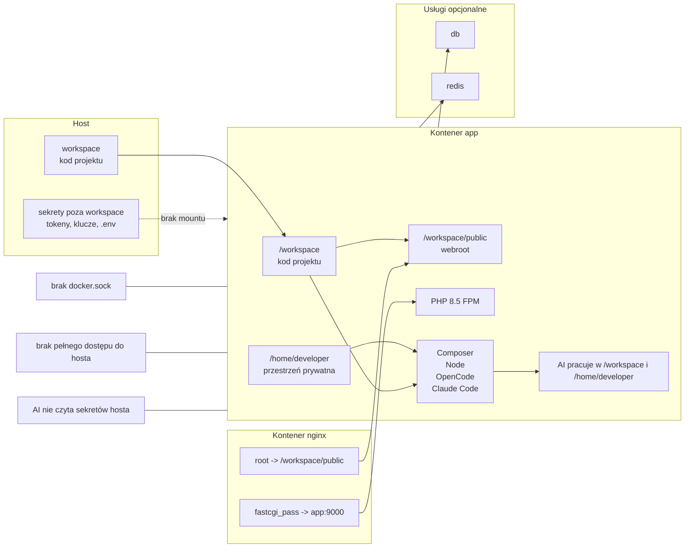

# RULES_WORK_SPACE

## Status
Dokument finalny dla etapu projektowego. Stanowi podstawę do budowy konfiguracji Dev Containera i usług towarzyszących.

## Cel
Zdefiniować zasady pracy dla Dev Containera w PhpStorm z naciskiem na:
- przewidywalny model katalogów,
- fizyczną izolację danych,
- wygodną pracę AI i użytkownika,
- minimalizację ryzyka przypadkowego dostępu do sekretów.

## Zasady architektoniczne

### 1. Główna zasada katalogów
- Na hoście projekt pracuje w katalogu typu `workspace`.
- W kontenerze projekt jest zawsze dostępny pod ścieżką `/workspace`.
- Ta mapa host → kontener jest stałą zasadą architektoniczną.[cite:72][cite:16]

### 2. Webroot
- Publiczny katalog aplikacji to `/workspace/public`.
- Nginx używa `root /workspace/public`.
- Żądania PHP są przekazywane z Nginx do PHP-FPM.[cite:95]

### 3. Model projektu
- Kod aplikacji jest dostępny w `/workspace`.
- `/workspace` jest głównym miejscem pracy dla PhpStorm, PHP, Composer, Node i narzędzi AI.
- Nie należy zmieniać tej ścieżki bez wyraźnej decyzji architektonicznej.[cite:16][cite:72]

### 4. Granica danych
- Wszystko, co ma być dostępne dla AI, musi znajdować się w katalogu montowanym do `/workspace` albo w innym jawnie wskazanym katalogu.
- Wszystko, czego AI nie ma widzieć, musi fizycznie pozostać poza mountem do `/workspace`.[cite:72][cite:82]

### 5. Sekrety
- Sekrety, tokeny Google, klucze API i pliki wrażliwe nie mogą znajdować się w katalogu montowanym do `/workspace`.
- Klucze API i tokeny do usług zewnętrznych są traktowane jako szczególnie wrażliwe, ponieważ mogą generować koszty, dawać dostęp do płatnych zasobów albo umożliwiać nadużycia po wycieku.[cite:239][cite:241]
- Plik `.env.example` może być dostępny, ponieważ zawiera nazwy zmiennych i strukturę konfiguracji, a nie realne wartości.
- Plik `.env` z prawdziwymi wartościami nie powinien trafiać do `/workspace`.
- Baza danych jest traktowana jako szczególnie wrażliwa przede wszystkim na produkcji; środowisko developerskie korzystające z danych fejkowych lub testowych nie jest klasyfikowane na tym samym poziomie ryzyka co produkcja.

### 6. Przestrzeń prywatna kontenera
- Prywatną przestrzenią pracy kontenera jest `/home/developer`.
- W tym katalogu AI i użytkownik mogą swobodnie tworzyć pliki robocze, cache, notatki i narzędzia pomocnicze.
- Kod projektu nie powinien być tam traktowany jako główne źródło aplikacji.

### 7. Polityka dostępu do hosta
- Root w kontenerze nie oznacza prawa do hosta.
- Dostęp do plików hosta istnieje tylko tam, gdzie został jawnie przyznany przez mount.
- Zalecane jest nie przyznawać dostępu do hosta, jeśli nie jest to konieczne.

### 8. Docker Secrets i konfiguracja
- Docker Secrets stosuje się tylko tam, gdzie aplikacja realnie czyta sekret z pliku.[cite:146][cite:130]
- Jeśli usługa nie obsługuje odczytu sekretu z pliku, nie wymusza się sztucznego użycia Docker Secrets.
- AI nie powinna mieć powodu do odczytu sekretów, nawet jeśli są dostępne jako pliki w kontenerze.[cite:147][cite:130]
- Plik `.env` poza `/workspace` może być używany wyłącznie do konfiguracji niesensytywnej.
- Plik `.env.example` może pozostawać w `/workspace` jako źródło nazw zmiennych konfiguracyjnych.

## Decyzje końcowe
- Projekt na hoście jest montowany do `/workspace` w kontenerze.
- Webroot aplikacji to `/workspace/public`.
- AI i narzędzia pracują na kodzie w `/workspace` oraz w prywatnym `/home/developer`.
- Sekrety nie mogą znajdować się w mountowanym `/workspace`.
- Klucze API i tokeny do usług zewnętrznych są traktowane jako szczególnie wrażliwe.
- Baza danych jest traktowana jako szczególnie wrażliwa przede wszystkim na produkcji, a nie w zwykłym development z danymi fejkowymi.
- `.env.example` może być dostępny w `/workspace`.
- `.env` z prawdziwymi wartościami nie powinien trafiać do `/workspace`.
- Root w kontenerze nie oznacza prawa do hosta.
- Dostęp do plików hosta istnieje tylko tam, gdzie został jawnie przyznany przez mount.
- Zalecane jest nie przyznawać dostępu do hosta, jeśli nie jest to konieczne.
- Docker Secrets stosuje się tylko tam, gdzie aplikacja realnie czyta sekret z pliku.
- AI nie powinna mieć powodu do odczytu sekretów, nawet jeśli są dostępne jako pliki w kontenerze.
- `.env` poza `/workspace` może być używany wyłącznie do konfiguracji niesensytywnej.

## Diagram architektury
Poniższy diagram Mermaid pokazuje przyjęty model pracy projektu, kontenerów i granic dostępu. GitHub renderuje diagramy Mermaid bezpośrednio w plikach Markdown.[cite:151][cite:159]

## Zasada operacyjna
Jeśli coś ma być niedostępne dla AI, nie powinno być montowane do kontenera wcale. Jeśli coś ma być dostępne, powinno być montowane jawnie i możliwie wąsko.[cite:72][cite:82]

## Następny etap
Na podstawie tego dokumentu można przejść do budowy:
- `Dockerfile`,
- `docker-compose.yml`,
- `devcontainer.json`,
- konfiguracji Nginx,
- zasad montowania i wolumenów,
- konfiguracji usług dodatkowych.
